# Лабораторная работа № 3

**Тема:** Контейнеризация веб-сервера в Docker и раздача сжатых файлов со стороны Nginx

**Репозиторий:** https://github.com/LaminarVortex/ARPO_Lab1

---

## Шаг 1. Настройка сборки со сжатием

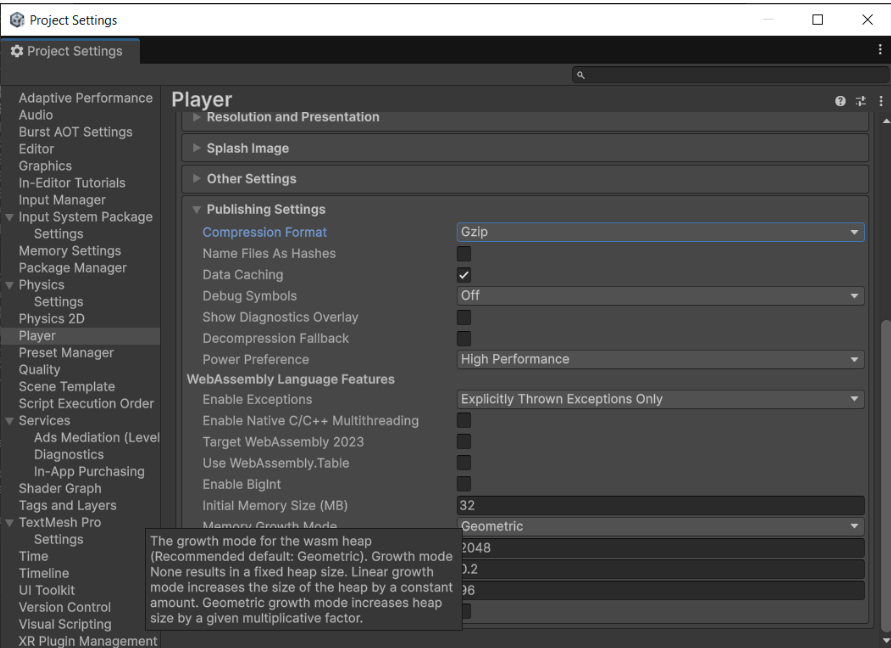

## Шаг 2. Получение сжатых файлов

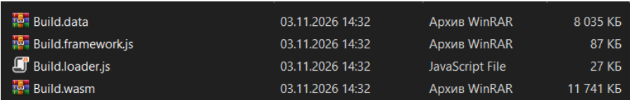

## Шаг 3. Создание файла nginx.conf

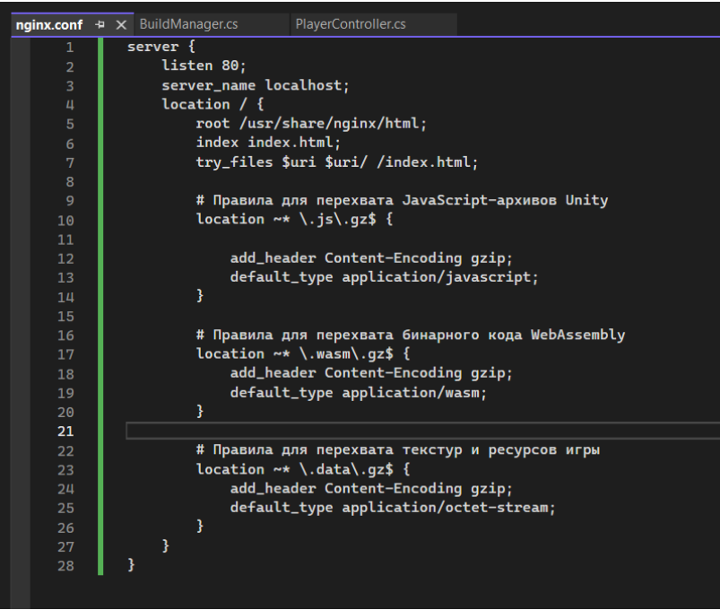

## Шаг 4. Создание файла Dockerfile

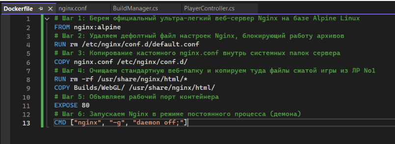

## Шаг 5. Сборка образа игры

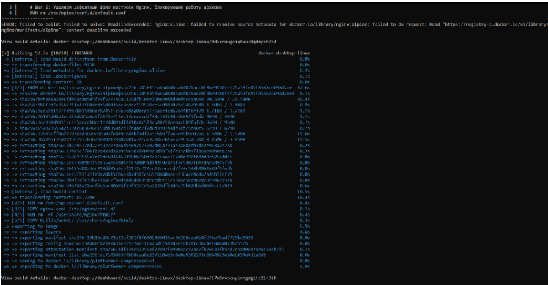

## Шаг 6. Запуск контейнера в фоновом режиме

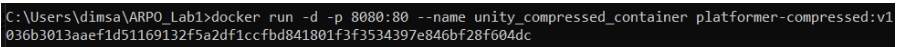

## Шаг 7. Проверка загрузки игры

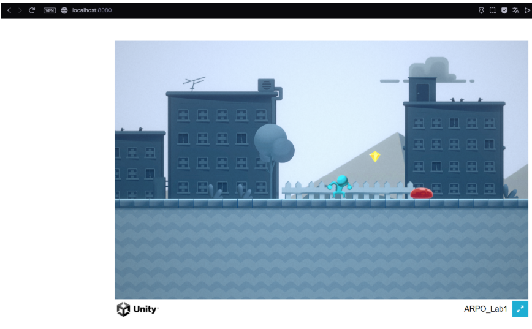

## Шаг 8. Проверка через инструменты разработчика

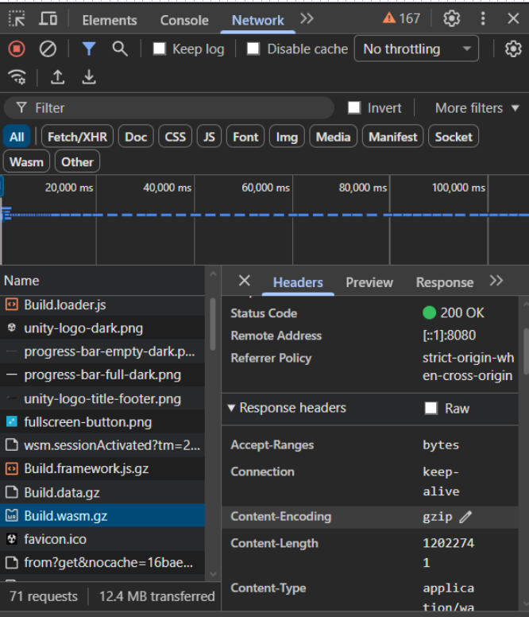

## Шаг 9. Остановка тестового контейнера

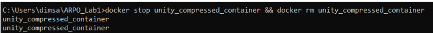

## Шаг 10. Добавление третьего этапа пайплайна

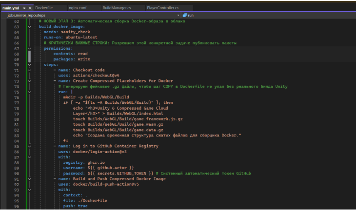

## Шаг 11. Добавление новых файлов и изменение main.yml на GitHub

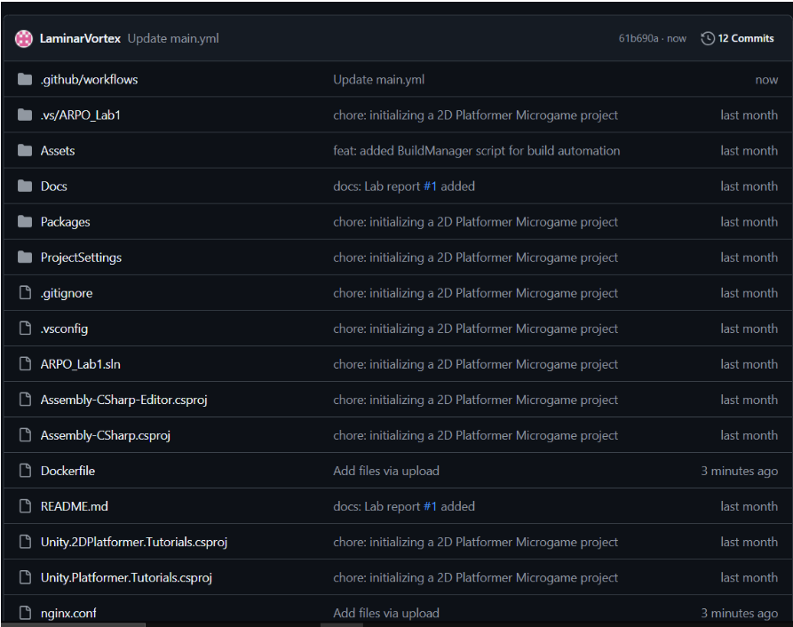

## Шаг 12. Успешное прохождение проверок

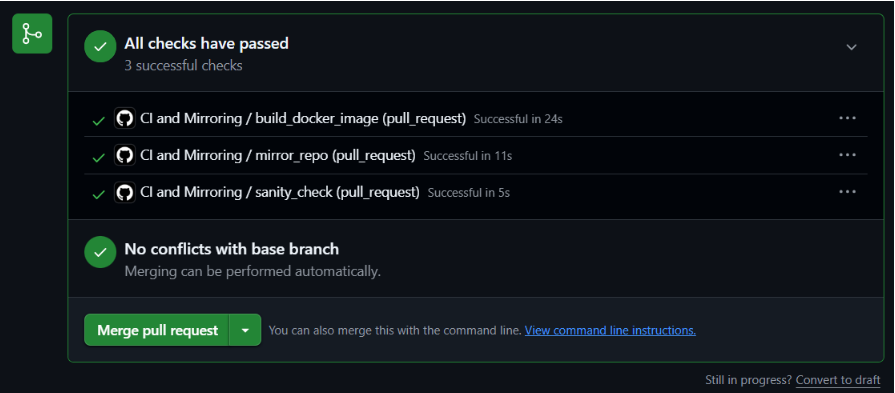

## Шаг 13. Готовый пакет игры

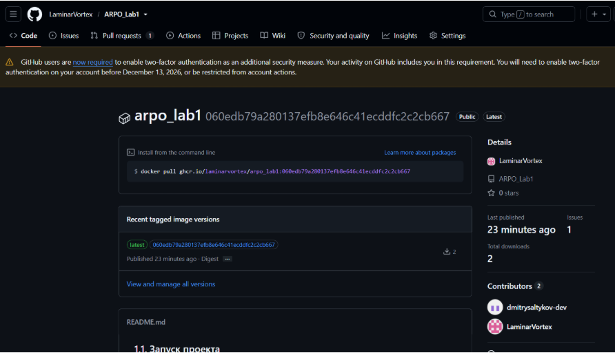

## Шаг 14. Заголовок Content-Encoding

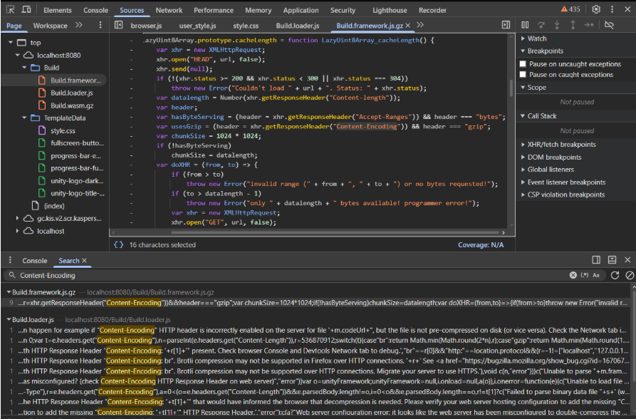
