# Лабораторная работа № 4

**Тема:** Автоматизация тестирования (Unity Test Runner) в CI/CD
**Вариант:** 11

**Репозиторий:** https://github.com/LaminarVortex/ARPO_Lab1

---

## Шаг 1. Создание файла GameAssembly.asmdef

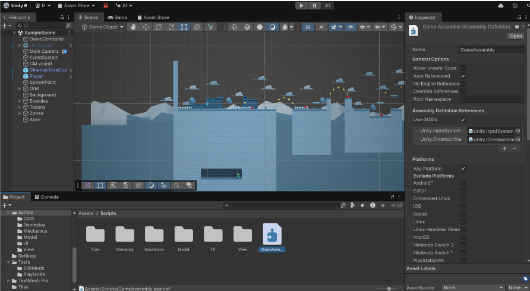

## Шаг 2. Создание файла Tests.asmdef в папке Tests/EditMode

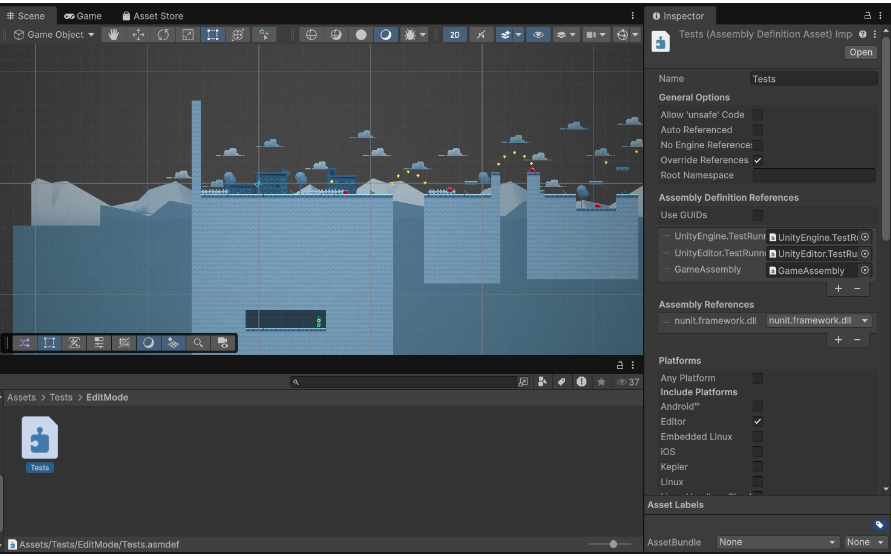

## Шаг 3. Создание файла PlayModeTests.asmdef в папке Tests/PlayMode

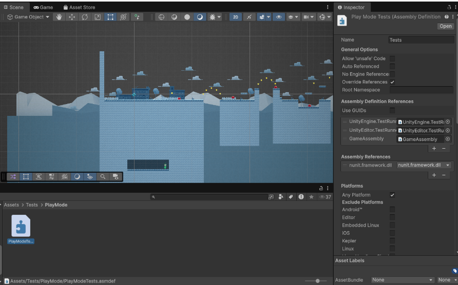

## Шаг 4. Успешное прохождение тестов Tests

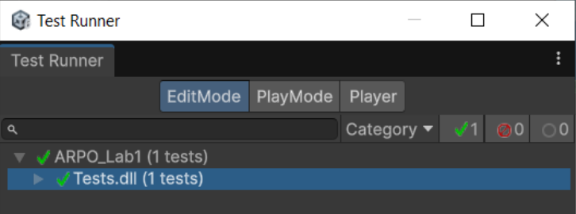

## Шаг 5. Успешное прохождение тестов PlayModeTests

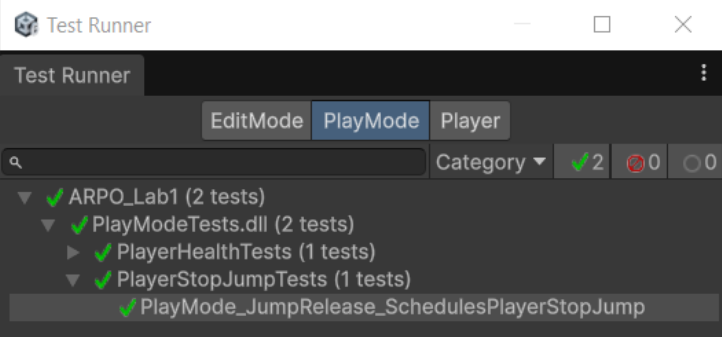

## Шаг 6. Добавление автозапуска тестов

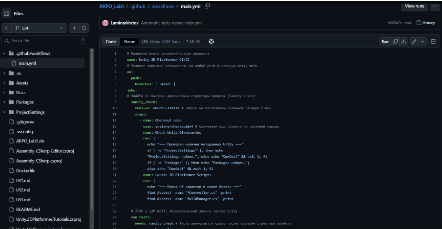

## Шаг 7. Добавление секретов

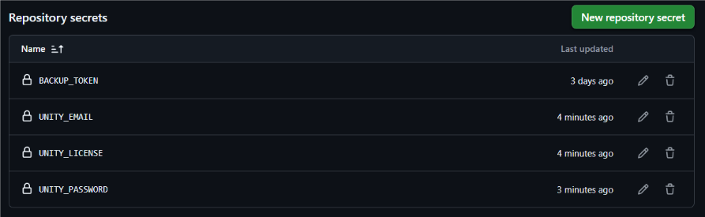

## Шаг 8. Успешное прохождение проверок

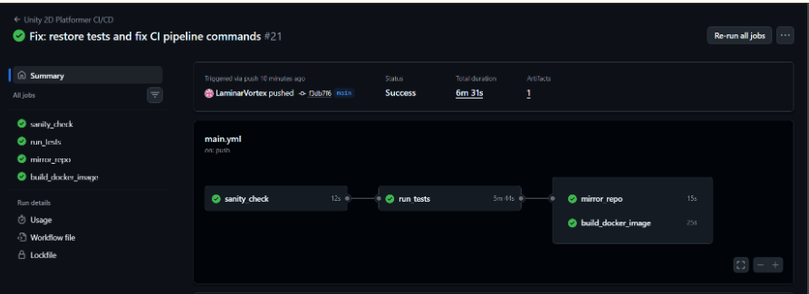

## Шаг 9. Файлы логов результатов тестов

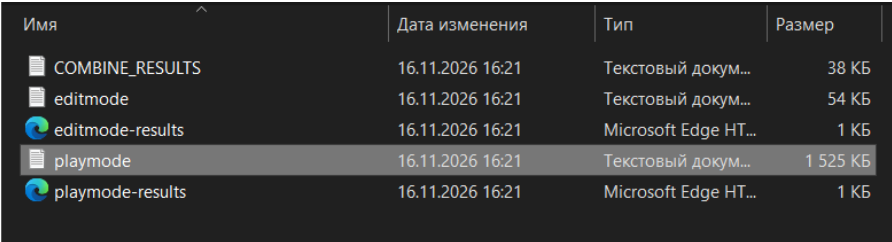

## Шаг 10. Папки с файлами тестов

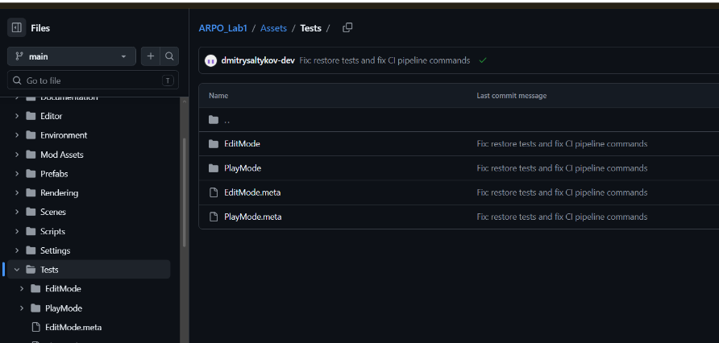

## Шаг 11. Файл GameAssembly.asmdef

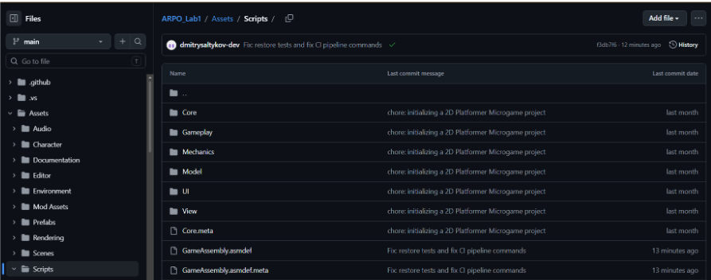

## Шаг 12. Демонстрация защиты пайплайна при непрохождении теста

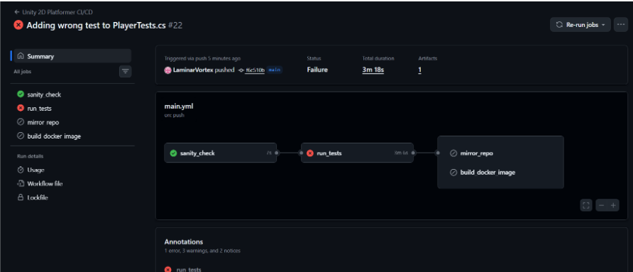
